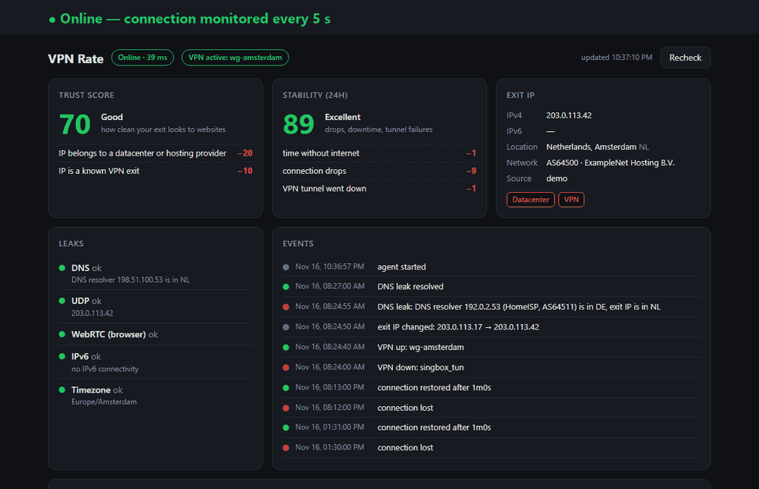
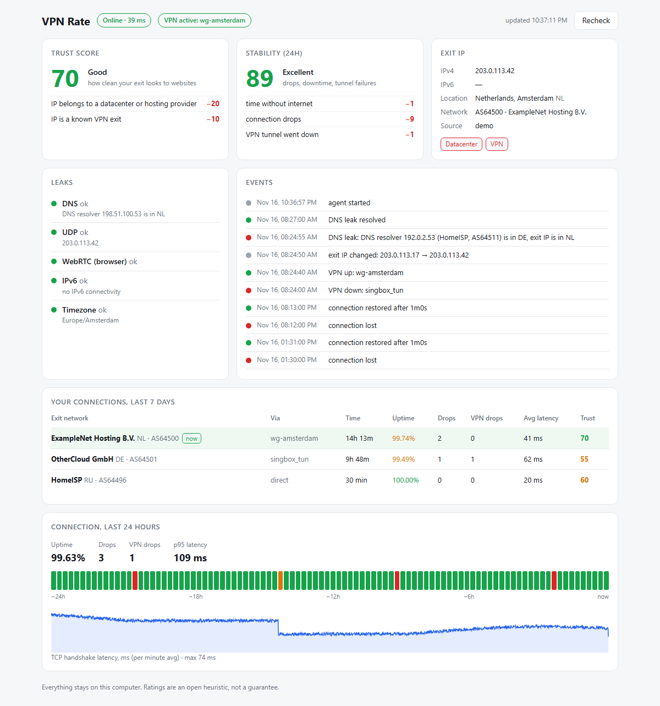
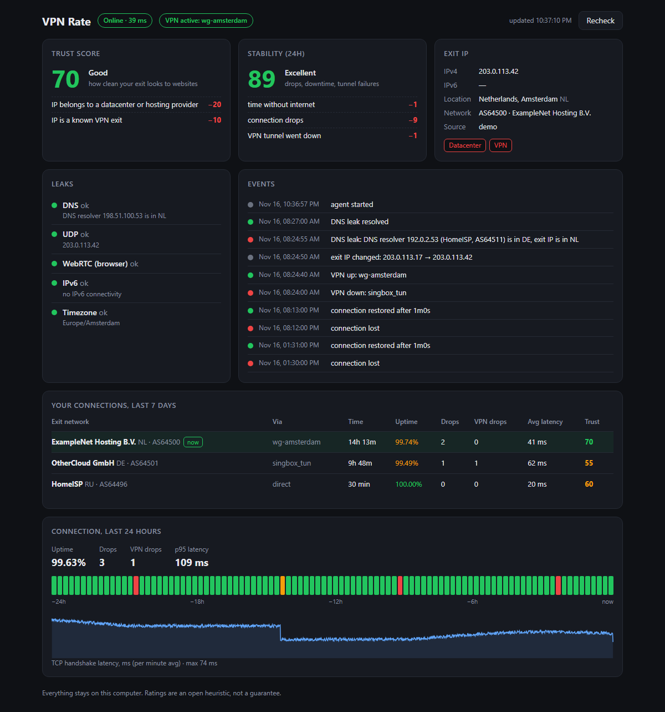
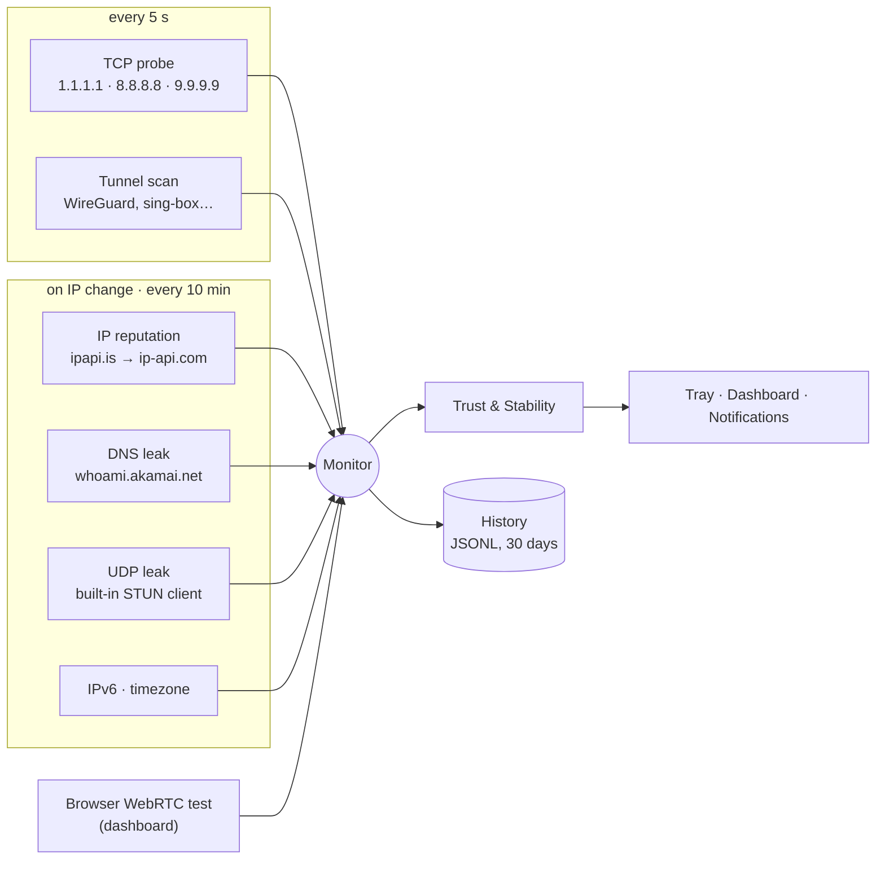

<div align="center">


# VPN Rate

**Is your VPN actually protecting you, all day long?**

A tiny background agent that watches your connection around the clock and tells you how
**stable** it is and how **clean** your exit IP looks to the websites you care about.

[](https://github.com/F7EVENTEEN/Vpnrate/actions/workflows/ci.yml)
[](https://github.com/F7EVENTEEN/Vpnrate/releases/latest)


[**Features**](#-features) · [**How it works**](#-how-it-works) · [**Scoring**](#-scoring) · [**Install**](#-install) · [**FAQ**](#-faq) · [**Русский**](README.ru.md)

<br>



<sub>Demo data. Run <code>vpnrate -demo</code> to see this on your own machine, no network access needed.</sub>

</div>

---

## 🤔 Why

AI services and Google increasingly restrict accounts that come from "bad" IPs: datacenter
ranges, known VPN exits, leaky setups. Online checkers give you a **one-second snapshot**.
But your VPN can drop for ten seconds at 3 a.m., quietly send your DNS through your ISP,
or hop to a blacklisted exit, and a snapshot will never show you that.

VPN Rate stays in the tray and remembers **everything that happens over time**.

| | Online checkers | **VPN Rate** |
|---|:---:|:---:|
| IP type, ASN, country | ✅ | ✅ |
| DNS / WebRTC / IPv6 leaks | ✅ | ✅ |
| Watches **24/7** in the background | ❌ | ✅ |
| Counts connection drops and VPN disconnects | ❌ | ✅ |
| Alerts you the moment a leak appears | ❌ | ✅ |
| History: when your IP changed and what it looked like | ❌ | ✅ |
| **Compares your VPNs** side by side | ❌ | ✅ |
| Open, explainable scoring formula | ❌ | ✅ |
| Your data never leaves your computer | ❌ | ✅ |

## ✨ Features

- 📶 **Stability monitoring:** tiny TCP probes every 5 seconds, so every outage is logged with its duration
- 🔌 **VPN tunnel watch:** spots WireGuard, AmneziaWG, OpenVPN, sing-box, Hiddify, Outline, Wintun/TAP and more, and tells you when one goes down
- ⚖️ **Compare your VPNs:** each exit network gets its own row with uptime, drops, latency and trust, so after a week you know which VPN is actually better
- 🧦 **Works with proxy-mode clients** too (v2rayN, Nekoray, Hiddify, Clash without TUN): it follows the Windows system proxy just like your browser does
- 🕵️ **Leak detection:** DNS, UDP/WebRTC (system-wide and in your browser), IPv6 bypass, timezone mismatch
- 🏷️ **IP reputation:** datacenter, VPN, proxy, Tor, abuse records, ASN and location, looked up only when your IP changes
- 🧮 **Two open scores:** Trust and Stability, each deduction listed with its reason
- 🔔 **Windows notifications:** for drops longer than 30 s, VPN disconnects, IP changes and new leaks
- 🟢 **Tray icon** that turns green, yellow or red at a glance, plus a clean local dashboard in light and dark themes, in English and Russian
- 🪶 **Featherweight:** one 8 MB `.exe`, no runtime, ~25 MB RAM, near-zero CPU
- 🔒 **Private by design:** no accounts, no telemetry, and it never contacts AI sites itself

<details>
<summary>📸 <b>More screenshots</b></summary>
<br>

| Light | Dark |
|---|---|
|  |  |

</details>

## 🔍 How it works



| Check | How | When |
|---|---|---|
| Connectivity and drops | TCP handshake to 1.1.1.1 / 8.8.8.8 / 9.9.9.9 on :443; offline after 2 misses | every 5 s |
| VPN tunnel up/down | Network adapters matched by name, description and interface type | every 5 s |
| Public IPv4 / IPv6 | ipify, icanhazip, ifconfig.co, with fallback | every 90 s |
| IP reputation | [ipapi.is](https://ipapi.is), falling back to [ip-api.com](https://ip-api.com), cached for 24 h | on IP change |
| DNS leak | `whoami.akamai.net` reveals the resolver that really serves you; its country is compared with your exit's | on IP change, every 10 min |
| UDP / WebRTC leak | Built-in STUN client: the UDP exit must match the HTTP exit | on IP change, every 10 min |
| WebRTC in the browser | The dashboard gathers ICE candidates in your browser | whenever it's open |
| IPv6 leak | IPv6 exit in a different country or ASN than IPv4 | on IP change |
| Timezone | System UTC offset vs. the IP's timezone (more than 1 h apart) | on IP change |

## 🧮 Scoring

### Trust: how clean your exit looks (0–100)

Starts at **100**, then subtracts:

| Signal | Points |
|---|---:|
| 🧅 Tor exit node | −50 |
| 🌍 Exit country not supported by major AI services (RU, BY, CN, HK, MO, IR, KP, SY, CU) | −40 |
| 🚫 Abuse / blacklist records | −25 |
| 🏢 Datacenter / hosting IP | −20 |
| 🔐 Known VPN exit | −10 |
| 🔁 Known proxy | −10 |
| 💧 DNS leak | −15 |
| 💧 UDP / WebRTC leak | −15 |
| 💧 IPv6 leak | −15 |
| 🕐 Timezone mismatch | −10 |

🟢 **85+** excellent · 🟢 **70+** good · 🟡 **50+** suspicious · 🔴 **below 50** high risk

### Stability: last 24 hours (0–100)

```
100 − 2 × downtime%
    − 3 × drops            (max 30)
    − 1 × tunnel drops     (max 20)
    − latency penalty      (p95 > 300 ms: 5, > 800 ms: 10)
```

> [!NOTE]
> No AI provider publishes how it scores IPs. These scores are an informed, transparent heuristic, not a guarantee.
> The whole formula fits in one file: [`internal/score/score.go`](internal/score/score.go).

## 🚀 Install

**Option 1: download.** Grab `vpnrate.exe` from [Releases](https://github.com/F7EVENTEEN/Vpnrate/releases) and run it.

**Option 2: Go.**

```
go install github.com/F7EVENTEEN/Vpnrate/cmd/vpnrate@latest
```

A green dot appears in the tray, and clicking it opens the dashboard at <http://127.0.0.1:8737>.
VPN Rate starts **the moment you log in**: it registers a per-user Task Scheduler logon task (no admin
rights, no startup delay, restarted if it fails) and falls back to the `Run` key if that's not possible.
Every launch checks the entry and repairs it, even if you move the exe. If it starts before Wi-Fi or
the VPN is up, it waits instead of logging a fake outage. Untick *Start with Windows* in the tray to turn it off.

```
vpnrate.exe [flags]

  -demo           show the dashboard with fake data (no network access)
  -headless       run without the tray, log events to stdout
  -port 8737      dashboard port (always bound to 127.0.0.1)
  -data DIR       where history is kept (default %APPDATA%\vpnrate)
  -no-autostart   don't touch the autostart entry during this run
  -version        print version
```

History lives in `%APPDATA%\vpnrate\` as plain JSON Lines, kept for 30 days.

### Build from source

```
git clone https://github.com/F7EVENTEEN/Vpnrate
cd Vpn_rate_agent
go test ./...
go build -ldflags "-s -w -H windowsgui" -o vpnrate.exe ./cmd/vpnrate
```

Requires Go 1.26+. No C compiler is needed.

## 🔒 Privacy

- The dashboard listens on **127.0.0.1 only** and rejects foreign `Host` headers (DNS rebinding) and non-JSON POSTs (cross-site requests).
- Outbound traffic goes only to the IP, reputation and STUN services listed above.
- VPN Rate **never contacts claude.ai, chatgpt.com or any other AI site**, so it can't send them a request from your real IP while your VPN is down.

## ❓ FAQ

<details>
<summary><b>How does it find my VPN? I didn't configure anything.</b></summary>
<br>Two ways, checked every 5 seconds. <b>TUN mode</b> clients (WireGuard, AmneziaWG, OpenVPN, sing-box…) create a virtual network adapter, which VPN Rate recognises by name, description and interface type. <b>Proxy mode</b> clients (v2rayN, Nekoray…) set the Windows system proxy, which VPN Rate reads and then routes its own checks through, so it sees the same exit as your browser.
</details>

<details>
<summary><b>I use several VPNs. Which one does it rate?</b></summary>
<br>Whichever one your traffic is actually using right now: only one route can carry it at a time. Every exit network (provider ASN + country) automatically becomes a <b>profile</b>, and its minutes, drops, VPN disconnects and trust are recorded separately. Switch VPNs or servers as usual, and the <i>Your connections</i> table compares them. Going without a VPN shows up as a "direct" row.
</details>

<details>
<summary><b>Proxy mode: why is UDP flagged as a leak?</b></summary>
<br>Because it is one. An HTTP/SOCKS system proxy only carries proxy-aware TCP traffic, so UDP (including browser WebRTC) goes out directly and can reveal your real IP. Switch your client to TUN mode, or disable WebRTC in your browser, to fix it.
</details>

<details>
<summary><b>Will a high score guarantee I won't get banned?</b></summary>
<br>No. Nobody outside those companies knows their exact rules. VPN Rate checks the signals that are publicly known to matter, so you can spot problems before a service does.
</details>

<details>
<summary><b>Why does my VPN get "−20 datacenter"?</b></summary>
<br>Most VPN servers live in datacenters, and reputation databases know it. Residential or mobile exits look more like regular users. That's a choice about your VPN provider, not a bug.
</details>

<details>
<summary><b>Google DNS answers from another country. Is that a leak?</b></summary>
<br>No. Public anycast resolvers (Google, Cloudflare, Quad9, OpenDNS, AdGuard, NextDNS) answer from the nearest point of presence, which is often across a border. A leak is when your <i>ISP's</i> resolver shows up while you're on a VPN.
</details>

<details>
<summary><b>Does it slow down my internet?</b></summary>
<br>No. A probe is a single TCP handshake every 5 seconds, a few bytes. Reputation APIs are called only when your IP changes.
</details>

<details>
<summary><b>macOS / Linux?</b></summary>
<br>The core is cross-platform. The tray, autostart and notifications are Windows-only for now. Contributions are welcome!
</details>

## 🗺️ Roadmap

- [ ] macOS and Linux tray, autostart and notifications
- [ ] More reputation sources (Spamhaus DNSBL and others)
- [ ] Weekly report export
- [ ] Signed release builds

## 📦 How releases are built

Releases are not uploaded by hand. Pushing a version tag (`git tag v0.2.0 && git push --tags`) triggers
[GitHub Actions](.github/workflows/release.yml), which tests and builds `vpnrate.exe` on a clean GitHub
machine from exactly that source, and attaches it with `SHA256SUMS.txt` to the release. Anyone can
check in the Actions log that the binary came from this code.

## 🤝 Contributing

Issues and PRs are welcome. Run `go test ./...` before submitting, and use `vpnrate -demo`
to work on the dashboard without touching your real network.

<div align="center">
<br>
<sub>If VPN Rate helped you catch a leak, a ⭐ helps other people find it.</sub>
</div>
