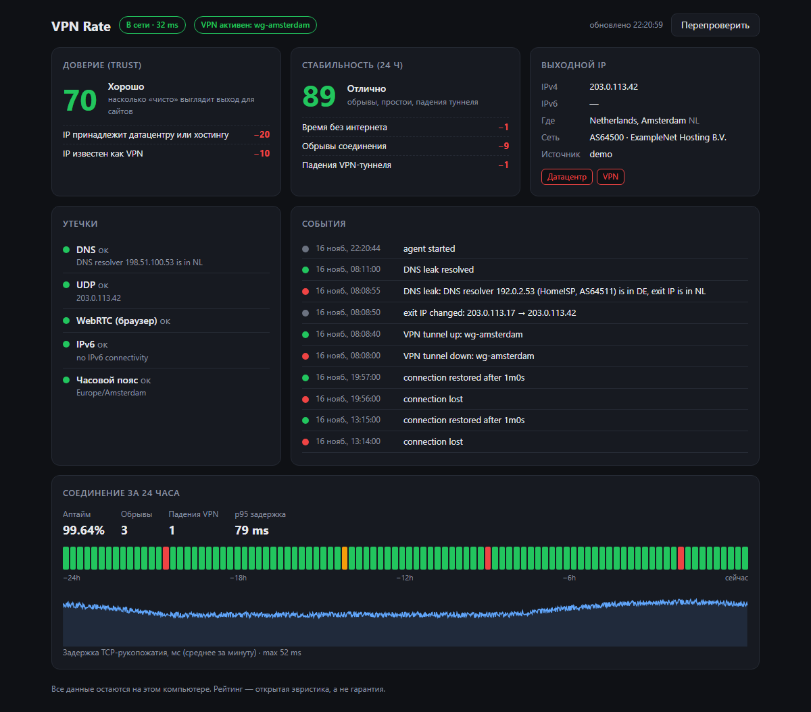

<div align="center">


# VPN Rate

**Твой VPN действительно защищает тебя весь день?**

Крошечный фоновый агент: круглосуточно следит за подключением и показывает, насколько оно
**стабильное** и насколько **чистым** твой выходной IP выглядит для сайтов.


[**Возможности**](#-возможности) · [**Рейтинг**](#-рейтинг) · [**Установка**](#-установка) · [**FAQ**](#-faq) · [**English**](README.md)

<br>



<sub>Демо-данные. Запусти <code>vpnrate -demo</code>, чтобы увидеть то же самое у себя без доступа к сети.</sub>

</div>

---

## 🤔 Зачем

AI-сервисы и Google всё чаще ограничивают аккаунты с «плохих» IP: датацентры, известные
VPN, конфигурации с утечками. Онлайн-чекеры показывают **снимок за одну секунду**. А VPN
может отвалиться на десять секунд в три часа ночи, тихо пустить DNS через провайдера или
перескочить на IP из чёрного списка, и снимок этого никогда не покажет.

VPN Rate живёт в трее и **помнит всё, что происходит во времени**.

| | Онлайн-чекеры | **VPN Rate** |
|---|:---:|:---:|
| Тип IP, ASN, страна | ✅ | ✅ |
| Утечки DNS / WebRTC / IPv6 | ✅ | ✅ |
| Следит **24/7** в фоне | ❌ | ✅ |
| Считает обрывы и падения VPN | ❌ | ✅ |
| Уведомляет, как только появилась утечка | ❌ | ✅ |
| История: когда сменился IP и каким он был | ❌ | ✅ |
| Открытая, объяснимая формула рейтинга | ❌ | ✅ |
| Данные не покидают компьютер | ❌ | ✅ |

## ✨ Возможности

- 📶 **Стабильность:** микро-проба TCP каждые 5 секунд, каждый обрыв записывается с длительностью
- 🔌 **Слежение за VPN-туннелем:** WireGuard, AmneziaWG, OpenVPN, sing-box, Hiddify, Outline, Wintun/TAP и другие
- 🕵️ **Утечки:** DNS, UDP/WebRTC (системно и в браузере), IPv6 мимо туннеля, часовой пояс
- 🏷️ **Репутация IP:** датацентр, VPN, прокси, Tor, абьюз. Запрос идёт только при смене IP
- 🧮 **Две открытые оценки,** Trust и Stability, у каждого штрафа указана причина
- 🔔 **Уведомления Windows:** обрыв дольше 30 с, падение VPN, смена IP, новая утечка
- 🟢 **Значок в трее** (зелёный / жёлтый / красный) и дашборд в светлой и тёмной теме
- 🪶 **Лёгкий:** один `.exe` на 8 МБ, ~25 МБ ОЗУ, CPU почти ноль
- 🔒 **Приватный:** без аккаунтов и телеметрии. Агент **никогда сам не обращается к AI-сайтам**, иначе при упавшем VPN он сам отправлял бы туда запросы с твоего реального IP

## 🧮 Рейтинг

**Trust (0–100)** стартует со 100, штрафы: Tor −50, страна не поддерживается AI-сервисами −40,
абьюз / чёрные списки −25, датацентр −20, известный VPN −10, прокси −10, утечка DNS −15,
утечка UDP/WebRTC −15, утечка IPv6 −15, часовой пояс не совпадает −10.

**Stability (24 ч):** `100 − 2×простой% − 3×обрывы (макс. 30) − падения туннеля (макс. 20) − штраф за p95-задержку`.

Подробная таблица есть в [английском README](README.md#-scoring), вся формула лежит в
[`internal/score/score.go`](internal/score/score.go).

> [!NOTE]
> Ни один AI-провайдер не публикует, как оценивает IP. Рейтинг — прозрачная эвристика, а не гарантия.

## 🚀 Установка

Скачай `vpnrate.exe` из [Releases](https://github.com/F7EVENTEEN/Vpn_rate_agent/releases) и запусти.
Или поставь через Go:

```
go install github.com/F7EVENTEEN/Vpn_rate_agent/cmd/vpnrate@latest
```

В трее появится значок, по клику откроется дашборд <http://127.0.0.1:8737>. При первом
запуске агент добавляет себя в автозапуск (без прав администратора), выключить можно в
меню трея. История хранится в `%APPDATA%\vpnrate\`, 30 дней.

## ❓ FAQ

<details>
<summary><b>Высокий рейтинг гарантирует, что меня не забанят?</b></summary>
<br>Нет. Точных правил не знает никто, кроме самих компаний. VPN Rate проверяет признаки, которые известны публично, чтобы ты увидел проблему раньше сервиса.
</details>

<details>
<summary><b>Почему у моего VPN «−20 датацентр»?</b></summary>
<br>Почти все VPN-серверы стоят в датацентрах, и базы репутации это знают. Домашние и мобильные IP выглядят как обычные пользователи. Это вопрос выбора провайдера, а не баг.
</details>

<details>
<summary><b>Google DNS отвечает из другой страны. Это утечка?</b></summary>
<br>Нет. Публичные anycast-резолверы (Google, Cloudflare, Quad9 и другие) отвечают из ближайшей точки присутствия. Утечка — это когда при включённом VPN виден резолвер твоего <i>провайдера</i>.
</details>

<details>
<summary><b>Замедляет ли он интернет?</b></summary>
<br>Нет. Проба — одно TCP-рукопожатие раз в 5 секунд, несколько байт.
</details>

Концепция и все решения описаны в [docs/CONCEPT.md](docs/CONCEPT.md).

<div align="center">
<br>
<sub>Если VPN Rate помог поймать утечку, поставь ⭐, так проект найдут другие.</sub>
</div>
